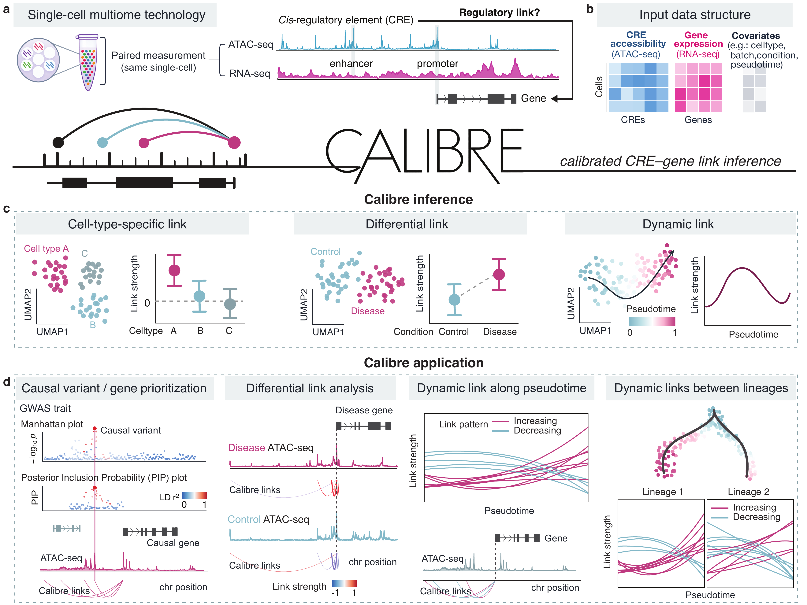

# Calibre

Calibre is an R package for computationally efficient, FDR-calibrated
inference of *cis*-regulatory element (CRE)–gene links from single-cell
multiome data.



## Key takeaways

- **Input:** paired single-cell RNA and ATAC-seq data.
- **Model:** Poisson GLMs by default, with negative binomial (NB) models as
  an alternative. User-specified technical and biological covariates are
  supported. `CalibreDynamic()` additionally models pseudotime effects using
  generalized additive models (GAMs).
- **Synthetic null data generation:** synthetic null data are generated under
  the null hypothesis using standardized Pearson-residual resampling.
- **FDR calibration:** original and synthetic-null test statistics are
  combined to calibrate the discovery threshold for FDR control.
- **Main analyses:**
  - Cell-type-specific link inference: `Calibre()`
  - Differential link inference between biological conditions:
    `CalibreDiff()`
  - Dynamic link inference along pseudotime: `CalibreDynamic()`

## Installation

To install the development version from GitHub, please run:

```r
if (!requireNamespace("remotes", quietly = TRUE)) {
  install.packages("remotes")
}
remotes::install_github("chexjiang/Calibre", dependencies = TRUE)
```

## Input data

`Calibre()` expects:

- `object`: a Seurat object containing RNA and ATAC assays with cell-level count data and metadata. To create the input Seurat object, run:

  ```r
  object <- Seurat::CreateSeuratObject(
    counts = rna_counts,
    meta.data = metadata,
    assay = "RNA"
  )

  object[["ATAC"]] <- Signac::CreateChromatinAssay(
    counts = atac_counts,
    sep = c("-", "-")
    # annotation = gene_annotation  # optional
  )
  ```
  where `rna_counts` and `atac_counts` are gene-by-cell and CRE-by-cell count
  matrices, respectively. `metadata` is a cell-by-covariate data frame, which
  may contain variables such as `celltype`, `nCount_RNA`, `pseudotime`,
  `condition`, and `batch`.

- `gene_peak_df`: a data frame of candidate CRE--gene pairs. For example:

  ```r
  gene_peak_df <- data.frame(
    gene = c("GENE1", "GENE2"),
    peak = c("chr1-100-200", "chr1-300-400")
  )
  ```

## Quick start

```r
library(Calibre)

# Infer significant CRE--gene links using all cells.
significant_links <- Calibre(
  object = object,
  gene_peak_df = gene_peak_df,
  celltype_col = "celltype",
  celltype = NULL,
  fdrcutoff = 0.1,
  returnObject = FALSE
)
```

By default, `Calibre()` returns a data frame containing the significant
CRE--gene links. Set `returnObject = TRUE` when the fitted results and
calibration metadata should remain attached to the Seurat object.

## `Calibre()` for cell-type-specific link inference

```r
Calibre(
  object,
  gene_peak_df,
  celltype_col = "newCT",
  celltype = NULL,
  covariates = NULL,
  fdrcutoff = 0.1,
  ncore = 10,
  stat = "zval",
  family = "poisson",
  null_generation = "s",
  bin = TRUE,
  selection = "rate",
  returnObject = FALSE,
  seed = 123
)
```

Important arguments:

- `object`: Seurat object with `RNA` and `ATAC` assays; required, with no
  default.
- `gene_peak_df`: data frame containing `gene` and `peak` columns; required,
  with no default.
- `celltype_col`: metadata column used to select cells by cell type; default
  is `"newCT"`.
- `celltype`: cell-type label to analyze; default is `NULL`, which uses all
  cells.
- `covariates`: optional cell-level covariates included in the GLM; default is
  `NULL`.
- `fdrcutoff`: target FDR level; the default is `0.1`.
- `ncore`: number of parallel workers on supported platforms; default is `10`.
- `stat`: test statistic used to rank pairs for FDR thresholding; default is
  `"zval"`. `"pval"` and `"beta"` are also supported.
- `family`: GLM family; default is `"poisson"`, with `"nb"` as the negative
  binomial alternative.
- `null_generation`: synthetic-null data generation scheme. The default, `"s"`, uses
  standardized Pearson-residual resampling.
- `bin`: whether to binarize ATAC counts before model fitting; default is
  `TRUE`.
- `selection`: candidate-pair filtering strategy; default is `"rate"`, which keeps
  pairs with both gene expression and CRE accessibility detected in at least
  5% of cells.
- `returnObject`: whether to return the updated Seurat object; default is
  `FALSE`, which returns the significant CRE--gene data frame.
- `seed`: master seed for reproducible pair-specific seeds; default is `123`.


## `CalibreDiff()` for differential link inference

To test for differential links between two conditions, use

```r
CalibreDiff(
  object,
  gene_peak_df,
  condition_col = "condition",
  condition_diff = c("condition1", "condition2"),
  celltype_col = "newCT",
  celltype = NULL,
  celltype_diff = NULL
)
```

Important arguments:

- `condition_col`: metadata column containing condition labels; default is
  `"condition"`.
- `condition_diff`: the two condition labels to compare; default is
  `c("condition1", "condition2")`. The second label is compared with the
  first.
- `celltype_col`: metadata column containing cell-type labels; default is
  `"newCT"`.
- `celltype`: optional single cell type used to subset cells; default is
  `NULL`, which uses all cell types.
- `celltype_diff`: set to `NULL` for condition comparisons.

`condition_diff` and `celltype_diff` are mutually exclusive. Replace the
placeholder labels with the values in the metadata and set the unused
comparison argument to `NULL`.

To test for differential links between two cell types, use

```r
CalibreDiff(
  object,
  gene_peak_df,
  condition_col = "condition",
  condition_diff = NULL,
  celltype_col = "newCT",
  celltype_diff = c("celltype1", "celltype2"),
  condition = NULL
)
```

Important arguments:

- `celltype_col`: metadata column containing cell-type labels; default is
  `"newCT"`.
- `celltype_diff`: the two cell-type labels to compare; default is
  `c("celltype1", "celltype2")`. The second label is compared with the first.
- `condition_col`: metadata column containing condition labels; default is
  `"condition"`.
- `condition`: optional condition label or labels used to subset cells; default
  is `NULL`, which uses all conditions.
- `condition_diff`: set to `NULL` for cell-type comparisons.

The remaining shared arguments have the same meaning and defaults as in
`Calibre()` and are omitted here for brevity. Donor-specific arguments are
documented in the package help.

## `CalibreDynamic()` for dynamic link inference along pseudotime

Assume that `object` has already been subsetted to cells from one
pre-specified lineage. To test for dynamic links along pre-defined
`pseudotime`, use:

```r
CalibreDynamic(
  object,
  gene_peak_df,
  pseudotime_col = "pseudotime",
  pseudotime_formula = "quadratic",
  covariates = NULL,
  stat = "chisq",
  fdrcutoff = 0.1
)
```

Important arguments:

- `object`: a Seurat object containing RNA and ATAC assays, already subsetted
  to the pre-specified lineage.
- `gene_peak_df`: a data frame of candidate gene–CRE pairs.
- `pseudotime_col`: metadata column containing finite numeric pseudotime
  values; default is `"pseudotime"`.
- `pseudotime_formula`: model for the dynamic effect; default is
  `"quadratic"`.
- `stat`: test statistic used to rank dynamic associations for FDR thresholding;
  default is `"chisq"`.

Other optional arguments retain their documented defaults and are omitted here
for brevity.


## License

Calibre is released under the MIT License. See [LICENSE](LICENSE) for the
full license text.
